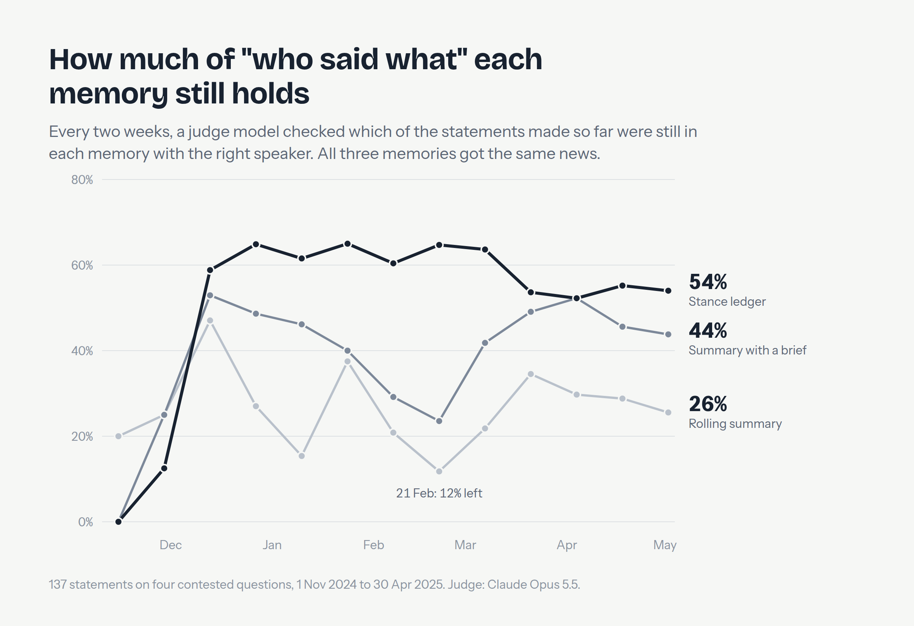

# srb-news-stance-ledger

**Keeping a disagreement in an agent's memory, as of any date.** An exploratory comparison of
how an AI agent can remember a contested news story: a **rolling summary** that the model
rewrites as news arrives, the same summary with a brief, and a **stance ledger** that keeps
every position as an attributed, dated record. A retrieval baseline and a closed-book model
sit alongside. The test bed is six months of Serbian online news about the protest movement
that followed the Novi Sad railway-station canopy collapse (1 Nov 2024), from the public
dataset [canopy-collapse-news-2024-2025](https://github.com/RatkoNikolic/canopy-collapse-news-2024-2025)
(v1.1.0, doi:10.5281/zenodo.23261738).

> **What this is and is not.** A small, single-run exploration of a memory method, with
> informal results. It never says which actor was right, does not compare news outlets, and
> names people only through their public office or party. Model outputs in this repository
> contain errors; the measured error rates are reported next to them.
>
> **Every stance here was extracted by a language model.** The answer key's 137 stances were
> found in the corpus by Claude, each with links to its articles. The ledger's 3,595 records were
> extracted by `claude-sonnet-5-5`: a check of 38 found about 84% acceptable. Paraphrases are the models' English, not quotes.
> Where a summary or paraphrase describes an outlet ("pro-government media", "opposition
> media"), those are the model's words, kept as written because how a memory attributes
> positions is what is measured; this project does not label outlets.

## What came out (single run, informal)



- **Rolling summaries lose most of what was said.** Every two weeks a judge (Claude Opus 5.5)
  checked which of the stances stated so far were still in each memory, with the right speaker.
  At the end of six months: the stance ledger held 54%, the rolling summary with a brief 44%, the
  plain rolling summary 26%. The summaries mostly dropped positions; after months of rewriting,
  the plain one also began repeating some sources' verdicts as fact.
- **Answering "as of" a date:** the ledger and the briefed summary recall about the same share of
  actors' current stances (41% vs 38%); the plain summary 25%, search with no memory 16%, the
  model alone 2%.
- **Changes of stance are where structure pays, and where it bites.** The ledger finds 2 to 3
  times as many stance changes as the briefed summary, and also reports changes that never
  happened: one misread article flips a consistent speaker. Requiring two independent outlets per
  change keeps the gain (41% detected) and cuts the noise by a third.
- **Cost:** keeping the ledger cost $3.69 for six months; each rolling summary about $7.40. The
  whole run, including evaluation, cost $25.40.

Details, intervals and limitations: [docs/RESULTS.md](docs/RESULTS.md).


## Three ways to use it

| | What | Needs | Time |
|---|---|---|---|
| **Browse** | The [viewer](docs/index.html) (`docs/`, served by GitHub Pages): pick a topic and a date, see every actor's stance as known then, earlier stances, links to the articles; and the three memories side by side at example dates | a browser | 2 min |
| **Ask** | `uv run stance-ledger show --topic T3 --as-of 2025-03-20` prints the ledger memory (free). `uv run stance-ledger ask "…" --as-of 2025-03-20 --arm ledger` asks the memory a question of your own | `uv`, an Anthropic API key for `ask` | 10 min |
| **Reproduce** | Rebuild the article texts from the outlets, then rerun every step | `uv`, the dataset's `canopy-news`, an Anthropic API key | hours |

### Reproduce

```bash
uv sync --extra dev
cp .env.example .env                       # ANTHROPIC_API_KEY

# 1. Article texts. The repository ships no text: fetch it from the outlets with the
#    dataset's own polite fetcher (robots.txt, >= 2 s per site, hash check per article).
#    About 9,500 articles, roughly 1.5-3 hours; a --limit slice is fine for exploring.
git clone https://github.com/RatkoNikolic/canopy-collapse-news-2024-2025 && cd canopy-collapse-news-2024-2025
uv sync && uv run canopy-news hydrate --index ../srb-news-stance-ledger/data/subset_index.parquet --out ../texts
cd ../srb-news-stance-ledger
uv run stance-ledger prepare --hydrated ../texts

# 2. Selection (free, deterministic): sentence windows and the shared 2-day bundles
uv run stance-ledger windows && uv run stance-ledger bundles

# 3. Memories and evaluation (paid; each step prints and enforces a budget)
uv run stance-ledger extract       # ledger: Haiku filter + Sonnet extraction, batch
uv run stance-ledger summaries     # rolling summaries, both variants
uv run stance-ledger answer        # questions at event-anchored checkpoints, batch
uv run stance-ledger judge         # attribution survival + stated-as-fact (Opus, batch)
uv run stance-ledger score && uv run stance-ledger report
```

The texts are the outlets' copyright: keep them for your own research and do not
redistribute them (see the dataset's `LICENSE-DATA.md` and its collectability check,
`PROTOCOL.md` §2). Articles edited since October 2026 come back as `changed` and are kept and
flagged; articles that are gone are left out, so a rerun is close to, not identical with, the
published one. Every window carries a SHA-256 of its text, so your copy can be checked span by
span.

## How it works

1. **Topics and propositions.** Four contested topics, nine propositions
   (`data/registry/propositions.json`): whether all reconstruction documentation was
   published; whether the students' demands were fulfilled, whether new demands were added,
   whether students demand snap elections; whether a sound device was used on 15 March 2025,
   whether the state owns one, what caused the sound; how many people attended the 15 March
   protest and the 12 April rally.
2. **Actors** (`data/registry/actors.json`): institutions, offices (keyed on the holder's
   term where it changed), parties, student assemblies, independent and foreign bodies, at the
   same level of detail on every side. Anyone else is "other" and never named.
3. **Selection.** Cue sentences per topic in the dataset's in-scope articles, with one
   sentence of context (`topics.py`, `windows.py`). Live blogs count as known the next morning.
4. **The shared input.** Every two days, up to 40 new windows per topic, at most 5 per outlet,
   wire copies dropped (`bundles.py`). All memory arms get exactly the same bundles.
5. **The arms.**
   - *Rolling summary*: the model rewrites a running summary from the previous one plus the
     new bundle (`summary.py`).
   - *Rolling summary + brief*: the same, told the propositions, the actor map and to
     attribute every stance and keep earlier ones.
   - *Stance ledger*: a cheap model drops windows with no stance; a stronger one extracts
     (actor, proposition, stance) records; code builds per-actor timelines and renders the
     memory from them, so nothing the model wrote earlier is rewritten (`extract.py`,
     `ledger.py`).
   - *Search (RAG)*: no memory; BM25 over the same articles up to the date (`rag.py`).
   - *Closed book*: the model alone, asked "as of" the date.
6. **Gold.** 137 stances found in the corpus with links to the articles, dated by first
   publication (`data/gold/`), extracted by Claude from a search of the corpus for each
   topic. Not exhaustive.
7. **Evaluation.** Questions at checkpoints around each gold change, answered by the same
   reader from each arm's memory as structured JSON and scored deterministically
   (`answer.py`, `score.py`). Every two weeks the strongest model in the set,
   `claude-opus-5-5`, checks each memory against every stance stated so far: still there with
   its speaker, turned into a fact, given to the wrong actor, or lost (`judge.py`).

Models: `claude-haiku-5-5` (filter), `claude-sonnet-5-5` (extraction, summaries, reader),
`claude-opus-5-5` (judge). Every call is in `runs/costs.jsonl`.

## Licence and citation

Code: Apache-2.0. Derived data (registry, gold, records, scores): CC BY 4.0. The articles
belong to their publishers and are linked, not copied. If you use this, please cite the
dataset (doi:10.5281/zenodo.23261738) and this repository.
