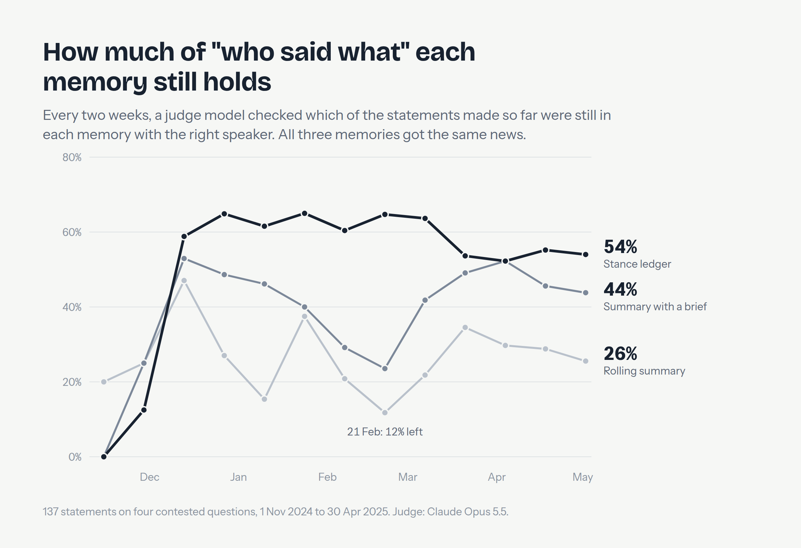

# Results (single run, 2026-10-12)

A demo, not a study: one story, one run of each memory, an answer key of 137 stances built from
the corpus. Every figure is reproducible from `runs/` with
`uv run stance-ledger score && uv run stance-ledger report`.

## Setup in one paragraph

Six months of Serbian news (1 Nov 2024 to 30 Apr 2025) on four contested topics: whether all
documentation on the railway-station reconstruction was published; whether the students'
demands were fulfilled (and whether new demands, or snap elections, were demanded); what
happened on 15 March 2025 (was a sound device used, does the state own one, what caused the
sound); and how many people attended the 15 March protest and the 12 April rally. Every two
days each memory received the same bundle of up to 40 new excerpts per topic (5,020 in total,
at most 5 per outlet). A reader (Claude Sonnet 5.5) answered 149 dated questions from each
memory, scored by code against the answer key; every two weeks a judge (Claude Opus 5.5) checked
which known stances each memory still held, and with whom.

## 1. Rolling summaries lose most of what was said

Share of the stances stated so far that the memory still holds, with the right actor:

| Snapshot | Rolling summary | Summary + brief | Stance ledger |
|---|---|---|---|
| 27 Dec 2024 | 27% | 49% | 65% |
| 21 Feb 2025 | 12% | 24% | 65% |
| 21 Mar 2025 | 35% | 49% | 54% |
| 2 May 2025 (end) | 26% | 44% | 54% |

At the end: the ledger holds 74 of 137 stances, the briefed summary 60, the plain summary 35.
The summaries rarely turn a stance into an unattributed fact (2 and 3); they **drop** positions
as they rewrite. The clearest case is the documentation question: the briefed summary held 12 of
22 stances at the end of December and 4 of 31 at the end of April; the ledger held 19 of 31 to
the end. The opposite case also happened: on the sound-device topic, short and dense, the briefed
summary kept slightly more than the ledger (24 vs 21 of 46), because the ledger's 600-word cap
leaves out the less-reported actors. For 44 of the 137 stances no evidence article reached any
memory's input at all, which caps every arm.

## 2. Answering questions as of a date

The same reader answered every question from each memory as structured JSON, scored
deterministically. Recall = share of actors' current stances (as of the date) given correctly.
95% intervals resample the 149 questions (paired).

| Memory | Recall | Stance changes detected | Changes reported | of which, actor has no change in the key |
|---|---|---|---|---|
| Stance ledger, corroborated (2 outlets per change) | 42% (39–45) | 41% (33–49) | 387 | 203 |
| Stance ledger, every record counts | 41% (38–44) | 23% (17–29) | 604 | 284 |
| Rolling summary + brief | 38% (34–42) | 13% (8–19) | 95 | 47 |
| Rolling summary | 25% (22–27) | 4% (1–7) | 37 | 23 |
| Search (BM25), no memory | 16% (14–17) | 7% (3–10) | 15 | 3 |
| The model alone | 2% (1–3) | 0% | 0 | 0 |

- **Recall:** the ledger and the briefed summary are level in this run (difference −3 to +8
  points); the ledger is clearly ahead of the plain summary (+13 to +20) and of search (+22 to +29).
- **Stance changes** are where the structure shows: the ledger finds 2 to 3 times as many as the
  briefed summary. It also reports changes the key does not have. Some are real changes the key
  missed; many are extraction errors turning into flips (one misread article and a consistent
  speaker "reverses"). Requiring two independent outlets before a change counts keeps recall,
  raises detection to 41% and cuts the reported changes by a third.
- **The model alone** declined to attribute stances it did not know (2% recall, no anachronisms).
  For actor-level detail on a regional story, the model's own knowledge was not a leak.
- **"Ahead of the key":** memories with dated input gave 3 to 8 stances per 100 that the key dates
  later. Input is filtered to the date in code, so this means the corpus carried those stances
  before the key's first date: the key dates some stances late.
- Two of the 894 answers have an empty prose field ("placeholder", "x"); their structured answers
  are complete and scored normally.

## 3. Stating a contested proposition as fact

The judge read every prose answer on the five contested propositions (105 per memory). The
ledger, both ledger settings, search and the model alone attributed throughout. The briefed
summary stated a contested proposition as fact once. The plain rolling summary did so 10 times,
in both directions (7 times that a proposition was false, 3 times that it was true): after months
of rewriting, it had taken on the verdicts of some of the excerpts it summarised and repeated them
in its own voice.

## 4. Extraction quality

A read of 38 extracted records against their source excerpts: about 32 acceptable (≈ 84%). Errors:
the outlet's own sentence recorded as an actor's stance; an announcement recorded as a stance;
"none fully fulfilled" recorded as "partial"; a stance filed under the wrong proposition. 682 of
3,595 records (19%) named no mappable actor and were left out. In 40 of the 2,913 records kept, the
model wrote JSON or tag fragments after the paraphrase sentence; the viewer cuts them for display,
the records file and the ledger memory keep them as the reader saw them.

## 5. Cost

| Stage | Calls | USD |
|---|---|---|
| Ledger: Haiku filter + Sonnet extraction (batch) | 8,086 | 3.69 |
| Rolling summary (Sonnet, sequential) | 219 | 7.41 |
| Rolling summary + brief (Sonnet, sequential) | 219 | 7.37 |
| Answering, 6 memories (Sonnet, batch) | 894 | 3.49 |
| Judge (Opus, batch): survival + stated-as-fact | 771 | 3.32 |
| Pilot | 98 | 0.11 |
| **Total** | | **25.40** |

Keeping the memory as a ledger cost half as much as keeping it as a rolling summary over the same
six months: extraction is per excerpt, parallel and batched; a rolling summary is rewritten in
full, in sequence, at full price.

## What this does not show

One story in one language, one run of each memory, an answer key that is itself model-extracted,
neither exhaustive nor double-coded. The summaries ran longer than the ledger (about 660 to 815 words against a 600-word
cap), which favours them. Nothing here says which actor was right, and no outlet is compared with
another.
